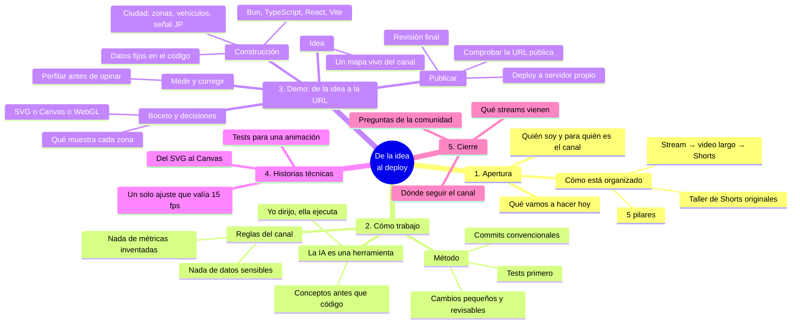

# Stream: De la idea al deploy

Stream de presentación del canal **JP Developer** (@jp-developer-ai). Explica qué es el canal y cómo trabajo, y hace una demo corta que va de una idea a una URL pública. La demo es la página `/canal` (la ciudad isométrica del canal), que ya existe y sirve de hilo conductor.

> Reglas del contenido: sin nombres reales de clientes (rubros o negocios ficticios), sin claves ni rutas privadas, sin cifras de audiencia ni métricas inventadas.

## Organigrama

## Guion por bloques

Tiempos orientativos; si algo se alarga, se recorta la demo, no la apertura.

### 1. Apertura (≈10 min)
- Presentación breve y para quién es el canal: desarrolladores.
- Mostrar el mapa `/canal` y recorrerlo: Fundación (el núcleo), Directos, Shorts · TikTok, Videos, Marketing y JP-Stack. Cada zona es una parte del flujo del canal.
- Explicar el flujo: cada stream produce **un video largo editado** y **Shorts técnicos**; otros Shorts nacen solos en el taller.
- Los cinco pilares: Construcción en vivo, Backend y datos, IA aplicada, Frontend y movimiento, Despliegue e infraestructura.
- Anunciar el plan del directo: de una idea a una URL pública.

### 2. Cómo trabajo (≈10 min)
- **La IA es una herramienta**: la dirección y las decisiones son mías. Mostrar cómo se redacta una petición con contexto y cómo se verifica lo que devuelve.
- **Conceptos antes que código**: no pedir código sin entender qué problema resuelve.
- **Método**: test en rojo primero, cambios pequeños, commits convencionales, nada se publica sin revisarlo.
- Comprobar siempre con evidencia (tests, tipos, el navegador), no por intuición.

### 3. Demo: de la idea a la URL (≈30 min)
1. **Idea**: "un mapa vivo que explique cómo se organiza el canal".
2. **Decisiones con trade-offs** (mostrarlas en voz alta):
   - SVG + GSAP: nítido y simple, pero se vuelve lento con mucha escena.
   - Canvas con una pirámide de imágenes: mucho más fluido, a cambio de más piezas propias.
   - WebGL / three.js: potente, pero pesado y difícil de hacer accesible.
3. **Construcción** (mostrar, no explicar todo): estructura del proyecto, datos fijos en `data.ts`, una zona, un vehículo, la señal con el logo, Spider-Man.
4. **Medir y corregir**: abrir el rendimiento, ver el cuello de botella y arreglar lo que mide, no lo que se sospecha.
5. **Publicar**: revisión final, deploy a servidor propio, abrir la URL pública y comprobar que carga (incluida la ruta sin barra final).

### 4. Historias técnicas para tener a mano
- **Del SVG al Canvas**: la primera versión en SVG iba lenta; se rehízo como Canvas sobre una pirámide de imágenes y pasó a ir fluida.
- **Un ajuste que lo cambió todo**: una opción de suavizado del canvas hacía copiar la textura en cada dibujo; se encontró con una traza de GPU, no a ojo.
- **Tests para algo que se mueve**: Spider-Man no es "se ve bien": hay tests de que la telaraña mantiene su largo, de que aterriza de pie y de que nunca atraviesa una torre.
- **Un detalle de XML**: las imágenes SVG se leen como XML y un atributo sin valor rompe todo; el test lo vigila.

### 5. Cierre (≈10 min)
- Lo que se ha construido y lo que salió de este stream.
- Próximos streams, del mapa: Setup con Bun, TypeScript y React; Q&A técnico y revisión de código; Convex; IA con streaming; animaciones con GSAP; de localhost a producción.
- Preguntas de la comunidad.

## Material que sale de este stream

Del propio mapa del canal (`src/canal/data.ts`):

- **Video largo editado**: "De la idea al deploy, versión editada": la demo completa sin pausas, con capítulos por etapa.
- **Shorts derivados**:
  - Truco: prototipar la pantalla antes que el backend.
  - Error común: desplegar sin separar las variables de entorno.
  - Antes / después: la idea en boceto vs. desplegada.

## Lista de preparación

**Antes del directo**
- [ ] Rama `feat/canal-map` al día y la página abierta en local (`bun run dev`, `/canal/`).
- [ ] `bun test` y `bunx tsc -p tsconfig.app.json --noEmit` en verde.
- [ ] Deploy de prueba hecho y la URL pública verificada, incluida `/canal` sin barra final.
- [ ] Pantalla de captura limpia: sin pestañas privadas, sin claves en terminales ni variables de entorno a la vista.
- [ ] Decidir qué se muestra del código (nada con rutas privadas ni credenciales).
- [ ] Recorrido ensayado: vista general → Directos → Marketing, y a Spider-Man en la calle del frente.
- [ ] Piezas de apoyo listas: este guion, el mapa, el panel de rendimiento.

**Durante**
- [ ] Marcar los momentos para los Shorts (los tres de arriba).
- [ ] Dejar tiempo para preguntas antes del deploy final.

**Después**
- [ ] Editar el video largo con capítulos por etapa.
- [ ] Cortar los tres Shorts derivados.
- [ ] Revisar que nada sensible se haya visto en pantalla antes de publicar.

## Si algo falla en directo
- **El rendimiento baja en una pantalla de alta densidad**: es un buen momento para enseñar el panel de rendimiento y explicar por qué la resolución se ajusta sola.
- **El deploy falla**: tener la URL ya publicada de la prueba anterior y enseñarla.
- **Se acaba el tiempo**: saltar los bloques 4 y la parte de Spider-Man; la apertura y el deploy son lo que no se puede perder.
